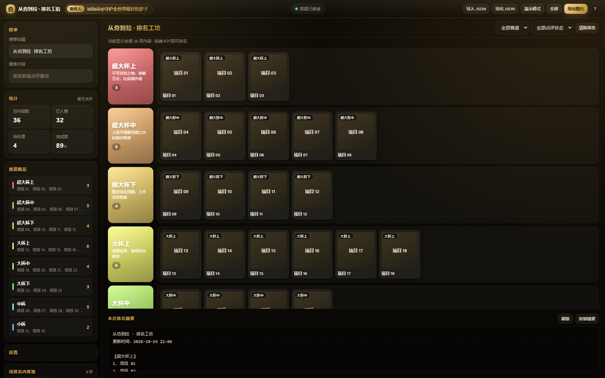

# 从夯到拉 · 排名工坊（ranking-workshop）

> 制作人：bilibili@守护全世界最好的梦子

一个用来做「从夯到拉」分档排名的 Windows 桌面小工具：上传图片或添加文字项，拖到对应赛道排好，
导出成一张图。独立窗口、自动保存、离线可用。



---

## 一、下载后怎么跑

1. 安装 [Node.js](https://nodejs.org/) 18 或更高（必须）；
2. 双击 **`启动程序.cmd`**。

程序会启动一个本地服务，并用 Edge / Chrome 的「应用模式」打开一个没有地址栏的窗口。
关闭窗口即自动退出；再次双击只会唤起已有窗口，不会重复启动。

也可以双击 **`静默启动.vbs`**，完全不显示命令行黑窗。

### 只想在浏览器里用？

```powershell
node server\server.js
```

终端会打印实际地址（默认 `http://127.0.0.1:7791/`），用浏览器打开即可。

### 环境要求

- Windows 10 / 11
- Node.js 18+（必需）
- Microsoft Edge 或 Google Chrome（系统一般自带）

启动脚本会依次在这些位置找 Node：

1. 程序目录下的 `runtime\node.exe`
2. 系统 PATH 里的 `node.exe`
3. `C:\Program Files\nodejs\node.exe`
4. `%LOCALAPPDATA%\Programs\nodejs\node.exe`

都没有会给出提示。想免安装的话，把 `node.exe` 放进程序目录的 `runtime\` 文件夹即可。

---

## 二、功能概览

| 类别 | 能力 |
| --- | --- |
| 内容 | 上传图片（多选）/ 拖拽图片文件 / `Ctrl+V` 粘贴截图 / 批量添加文字项 |
| 排名 | 拖拽入榜、赛道内拖动排序、详情弹窗内切换赛道 |
| 编辑 | 单击卡片改名称与点评、双击赛道名与榜单标题、赛道改名/改色/增删 |
| 检索 | 按名称与点评搜索，赛道筛选 + 点评状态筛选 |
| 显示 | 紧凑模式、显示名称、显示点评、赛道标题风格（卡片化/极简/霓虹）、三套主题 |
| 演示 | 自动全屏、悬浮按钮逐张召唤、图片尽量占满屏幕 |
| 输出 | 图片导出（可选带标题/内容池/摘要）、文字摘要复制、JSON 存档与导入 |
| 数据 | 改动自动写入 `data\state.json`，顶栏显示保存时间 |

### 默认赛道

8 档，配色取自参考图色带（红→橙→黄→淡黄→黄绿→绿→青→蓝）：

| # | 赛道 | 说明 | 颜色 |
| --- | --- | --- | --- |
| 1 | 超大杯上 | 不可名状之神，独断万古，比肩原作者 | `#f87e7d` |
| 2 | 超大杯中 | 人类可理解范围之内的绝对强者 | `#f8bf7c` |
| 3 | 超大杯下 | 稳定站在顶端，几乎没有短板 | `#fcdf7b` |
| 4 | 大杯上 | 表现优秀，值得优先推荐 | `#fdfd79` |
| 5 | 大杯中 | 中规中矩，适合放在中段 | `#c5fc7a` |
| 6 | 大杯下 | 表现偏弱，需要靠后排布 | `#8efc7f` |
| 7 | 中杯 | 删了没人知道 | `#8efeff` |
| 8 | 小杯 | 由于倒霉被人反复点名批评 | `#88bfff` |

点榜单最下方的「＋ 增加一个赛道」可继续追加，配色按色板循环并自动跳过已占用的颜色；
鼠标移到赛道头部有 🎨（改名/说明/颜色）和 ✕（删除，内容退回内容池）。

### 入榜动效

拖拽或点按入榜时有三段反馈：赛道整块按自己的颜色发光 → 卡片弹跳并扩散同色光环 → 顶部弹出「已入榜 · 赛道名」横幅。

### 快捷键

| 快捷键 | 功能 |
| --- | --- |
| `Ctrl + S` | 导出图片 |
| `Ctrl + F` | 聚焦搜索框 |
| `N` | 演示模式下召唤下一张 |
| `←` `→` | 详情弹窗内切换同赛道上一项 / 下一项 |
| `Esc` | 关闭弹窗 / 退出演示模式 |
| `Ctrl + V` | 粘贴截图上传 |
| `Ctrl + Enter` | 提交批量文字项 |

---

## 三、目录结构

```
ranking-workshop/
├─ 启动程序.cmd              双击启动
├─ 静默启动.vbs              无黑窗启动
├─ LICENSE                   MIT
├─ server/
│  └─ server.js              本地服务（零第三方依赖）
├─ web/
│  ├─ index.html             界面结构
│  ├─ styles.css             视觉样式
│  ├─ app.js                 交互逻辑
│  └─ vendor/
│     └─ html2canvas.min.js  导出图片用（本地文件，不需要联网）
├─ data/
│  └─ seed.json              初始榜单模板（首次启动会据此生成 state.json）
└─ 可选数据/                 （默认空）自己排好的榜单快照放这里
```

## 技术说明

- **零第三方依赖**：服务端只用 Node.js 标准库；前端是原生 JavaScript，没有框架、没有构建步骤。
- **离线可用**：`html2canvas` 已本地化到 `web/vendor/`，不请求任何 CDN。
- **数据格式**：`data\state.json` 是一个纯 JSON 文件（`{ version, boardTitle, settings, tiers, images }`），
  图片以 data URL 内嵌，所以单个文件即可完整搬移；损坏或删除后会用 `seed.json` 重建空榜单。

---

## 四、关于仓库里没有的个人数据

本仓库**不包含**作者自己那份 49 项榜单快照（`可选数据\榜单快照-49项.json`，约 6.7MB），
原因有两个：一是里面内嵌了大量动漫截图，公开分发涉及版权；二是属于个人作品数据。

如果你想保留自己的榜单，用程序里的「导出 JSON」按钮存一份即可，换电脑时复制 `data\state.json` 或
用「导入 JSON」恢复。

---

## License

[MIT](LICENSE) © 2026 守护全世界最好的梦子
